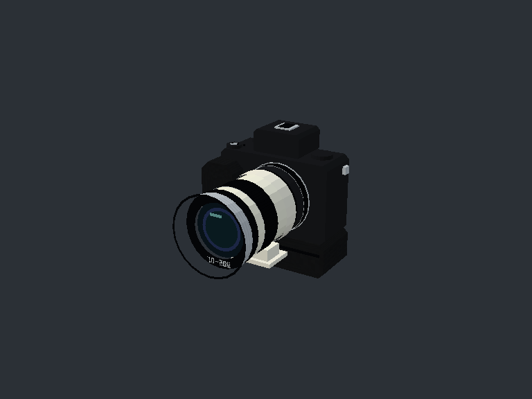
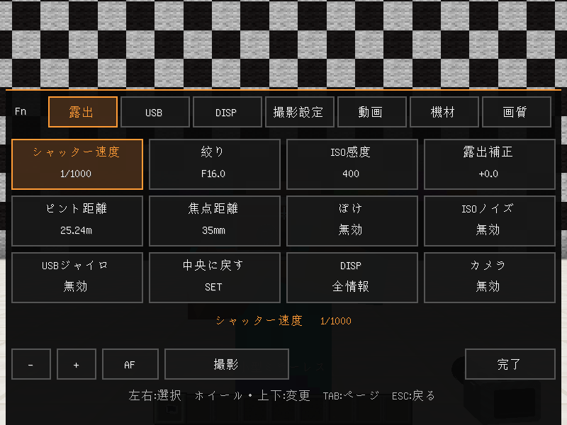

# Shakei release 1.0

Minecraft 1.7.10 / Forge用のカメラMODです。絞り・シャッター速度・ISO・ピントを調整して、写真と動画を撮影できます。

**[release 1.0をダウンロード](https://github.com/sakasaka20261027-sketch/Shakei/releases/tag/v1.0.0)**

Assets内の **Shakei-1.0.0-MC1.7.10.zip**（MOD・説明・規約・許諾文の一式）または **shakei-1.0.0.jar**（MOD本体）をご利用ください。

無料配布です。本体の無断改変・無断再配布は禁止です。[利用・配布条件](LICENSE.ja.txt)をご確認ください。第三者コンポーネントに適用されるMIT等の権利は維持します。

## カメラの機能

- 11種類のデジタル・フィルム・インスタントカメラ、19種類の交換レンズ、三脚、機材の置物。
- 絞り・シャッター速度・ISO、AF-S／AF-C／MF、ホワイトバランス、広角8mmから望遠600mm。
- 写真の3:2・4:3・1:1・16:9、縦向き撮影。フィルムはカメラごとの判型に対応。
- フィルム銘柄・デジタル色プロファイル、無制限または枚数制限付きフィルム、余白付きインスタント写真。
- デジタル動画、ゲーム音声、動体ブラー、強度を変更できる手振れ補正。
- 写真と別に選べる動画の1.85:1／2.39:1と縦向き出力。
- 専用クリエイティブタブ、マルチプレイで相手がカメラを構える姿勢の同期。

## 導入

必要環境：**Minecraft 1.7.10 / Forge 10.13.4.1614 / Java 8互換環境**。

1. ゲームを終了し、配布ZIPを展開します。
2. `mods/shakei-1.0.0.jar`を、使用するMinecraftのゲームフォルダー内の`mods`へ入れます。
3. 起動後、クリエイティブの「Shakei カメラ」タブから機材を取り出します。

旧版から更新するときはワールドと設定をバックアップし、旧版のJARを取り外してから導入してください。マルチで専用アイテムを使う場合はサーバーと全クライアントへ同じ版を入れてください。Minecraft・Forge・他のMOD・シェーダーは同梱していません。

## 基本操作

| 操作 | 初期キー・方法 |
| --- | --- |
| 構える／下ろす | カメラを持って **P** |
| メニュー | カメラを持って **M**。構えていなくても開けます |
| 写真 | 右クリック、または **F8** |
| デジタル動画の開始／停止 | **F9** |
| ピント合わせ | **F** |
| 写真・動画の画質 | **M → 画質** |
| 動画だけの比率 | **M → 動画 → 動画の比率** |
| 機材を置く | スニーク＋床上面を右クリック。レンズは縦置き |
| 三脚へ取り付ける | カメラを持って三脚を右クリック |
| 三脚から取り外す | スニーク＋三脚を右クリック |

キーが競合する場合はMinecraftの操作設定で変更できます。小さい画面のメニューは次ページのボタンで項目を切り替えます。

写真は元画面／長辺640・1280・1920、動画は自動／360p・540p・720p・1080pを選べます。比率に応じて実際の縦横寸法が変わります。動画の比率は写真と同じ（初期値）／1.85:1／2.39:1です。偶数ピクセルへ丸めるため、フルHD上限では1920×1038／1920×804になります。比率・画質の変更は録画を停止してから行ってください。

## 保存先

Minecraftのゲームフォルダー内の **screenshots** です。写真名は`SK_261118_120000.png`、動画名は`SV_261118_120000.mp4`のような形式です。

- 画面上のカメラUIを表示したまま撮影し、保存画像にはUI・プレイヤー名・JourneyMapのミニマップ／ウェイポイントを含めません。
- 写真の設定はPNG内に保存します。機材メニューで`.properties`の別保存も選べます。
- 有限フィルムは撮り切ってから`film/銘柄/日時_判型_枚数`へ保存します。無制限フィルムは現像操作後に銘柄別の無制限フォルダーへ保存します。
- インスタントは撮影ごとに白い余白を付けて保存します。

## release 1.0のUSBジャイロ

**スマートフォン用アプリとPC用USB接続ソフトは配布しません。** USBジャイロの受信機能はMOD本体に残しています。通常のマウス・キーボードによる撮影に、これらのソフトは必要ありません。

## 確認環境と制限

通常描画、SEUS Renewed v1.0.1、BSL v7.2、提供SEUS設定、KaizPatchX 1.10.3、JourneyMap 5.1.4p2でローカル検証しました。120テストと11項目のゲーム内検証、2クライアントのTCP接続を確認しています。専用サーバーの起動は今回の検証には含めていません。

動画録画はWindowsで動作確認しています。高解像度はGPU・保存負荷を増やします。描画が指定FPSに届かない場合はフレームが反復されます。ゲームの光は実測校正されておらず、隠れた背景・透明面・反射・TAAなどには再現上の近似が残ります。

## 規約・出典

- [Shakei 利用・配布条件](LICENSE.ja.txt)
- [第三者コンポーネントと出典](THIRD_PARTY_NOTICES.md)
- [Recipe Lab v1.7.0 MIT許諾文](licenses/recipe-lab-v1.7.0-MIT.txt)
- [Spectral Film LUT MIT許諾文](licenses/spectral-film-lut-MIT.txt)
- [release 1.0の変更内容](CHANGELOG.md)

不具合の報告は[Issues](https://github.com/sakasaka20261027-sketch/Shakei/issues)へ、MOD・Forge・描画MOD・シェーダーのバージョンと再現手順を添えてください。

ShakeiはMojang・Microsoft・カメラ／フィルムメーカーの公式製品ではありません。
